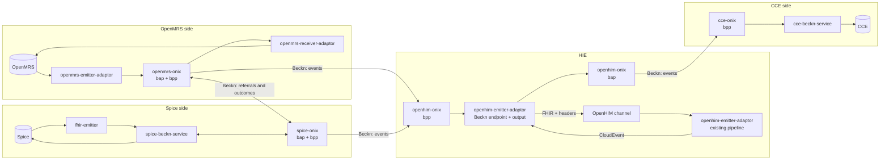
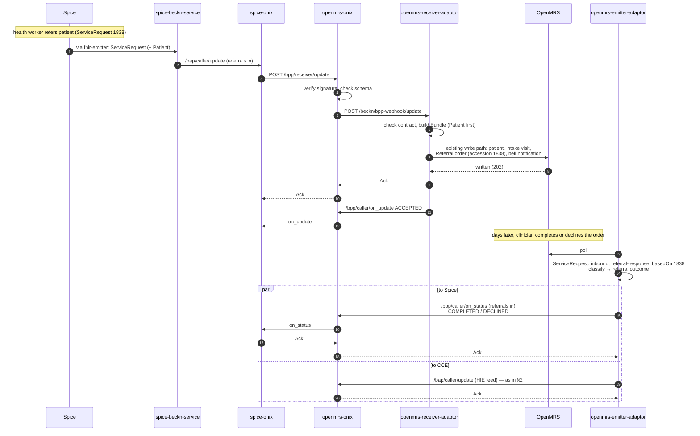
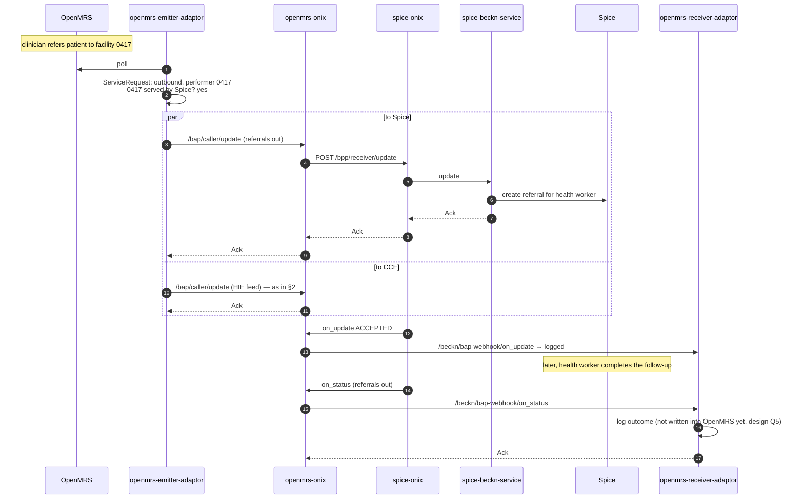
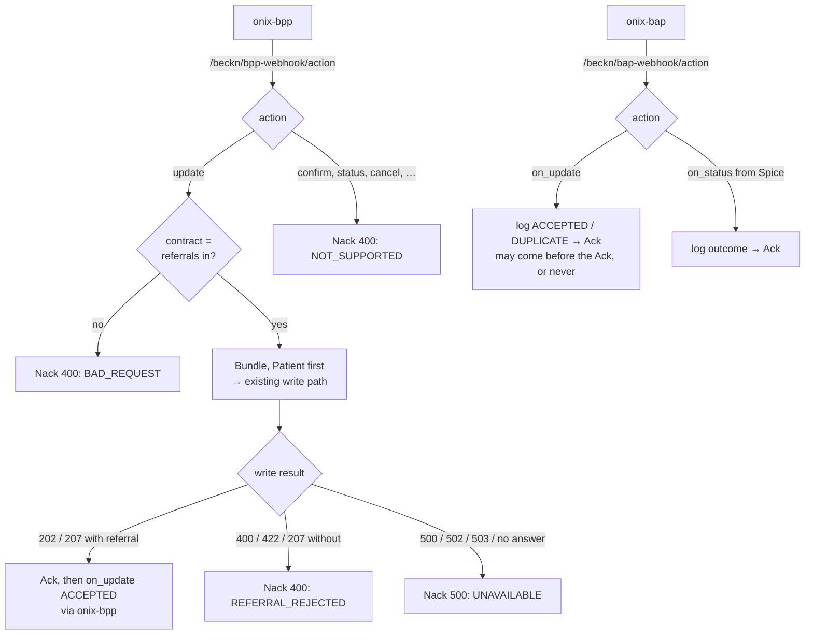

# Beckn Integration — OpenMRS CCE Receiver Adaptor

**Status:** Built for the demo. On by default on the `demo-beckn` branch (`OPENMRS_RECEIVER_BECKN_ENABLED=true`); set `OPENMRS_RECEIVER_BECKN_ENABLED=false` to switch it off. Where the code differs from the first proposal, this page has been updated; §11 lists those points.
**Design:** `openmrs-beckn-service/docs/design-openmrs-beckn-integration.md` ("the design"). This page covers the receiver's part only.

> **CCE legs moved to Sygnal.** CCE care alerts no longer come as a Beckn `on_status`: they arrive as Sygnal `sygnal/signal/emit` at `POST /sygnal/signal/emit` — see [sygnal-integration.md](sygnal-integration.md). OpenMRS → HIE → CCE events travel as Sygnal `sygnal/event/report`, so no `on_update` comes back from the HIE any more. The Spice ↔ OpenMRS referral flows on this page are unchanged, standard Beckn.
>
> **Change 2026-11-23: the box of the referral messages is a `sygnal:CoordinationEvent`.** In `update`, `on_update` and `on_status` between OpenMRS and Spice, the `performanceAttributes` box (where the message has one; the receiver's own `on_update`, §4.4, has none) is no longer a `cce:CceClinicalEvent` v1.0. It is the same object as the event of Sygnal `sygnal/event/report`, a `sygnal:CoordinationEvent`, with an `@context` first (§3.3). The schema is `schema/CoordinationEvent/v3.0/` in `cce-beckn-service`; `CceClinicalEvent/v1.0` and `CceCareAlert/v1.0` are deleted. The schema set of `onix-bap` and `onix-bpp` (onix 1.9.4) is now `CoordinationEvent/v3.0` plus the Health* pack (§8). Spice changes its boxes and its referral adapters at the same time; an adapter without the old schema refuses the old box (`SCH_SCHEMA_ADAPTATION_FAILED`). The receiver reads only `performanceAttributes.resource`, so what it does is unchanged. The `hrf:HealthReferral` flow (§4A) is unchanged.

The receiver gets two Beckn endpoints. They are an extra door into OpenMRS, not a replacement. The existing `POST /api/v1/openmrs/fhir` endpoint is unchanged, and with `OPENMRS_RECEIVER_BECKN_ENABLED=false` the receiver behaves exactly as today. On the `demo-beckn` branch Beckn is on by default.

---

## 1. The Four Flows

```
---- OpenMRS to CCE ----
openmrs-emitter-adaptor → openmrs-onix(bap) ══► openhim-onix(bpp) → openhim-emitter-adaptor (unwrap) → OpenHIM channel → openhim-emitter-adaptor
                                                                                                                         │
                                         cce-onix(bpp) ◄══ openhim-onix(bap) ◄── openhim-emitter-adaptor (wrap) ◄───────────┘
                                              │
                                              └──► cce-beckn-service → CCE

---- Spice to CCE ----
fhir-emitter → spice-beckn-service → spice-onix(bap) ══► openhim-onix(bpp) → … the same as above … → CCE

---- Spice to OpenMRS ----
Spice → fhir-emitter → spice-beckn-service → spice-onix(bap) ══► openmrs-onix(bpp) → openmrs-receiver-adaptor → OpenMRS

---- OpenMRS to Spice ----
OpenMRS → openmrs-emitter-adaptor → openmrs-onix(bap) ══► spice-onix(bpp) → spice-beckn-service → Spice
```

══ marks a Beckn hop: signed by the sender's adapter and checked by the receiver's adapter. ─ marks plain HTTP.

The receiver takes part in two of them:

- **Spice to OpenMRS.** It receives the referral and writes it into OpenMRS.
- **OpenMRS to CCE and OpenMRS to Spice.** It receives the callbacks (`on_update`, and Spice's `on_status`) for messages the emitter sent. It only logs them.

### 1.1 Flow diagrams

The diagrams below are the same as in the central design's flow diagrams. Mermaid notation. CCE care alerts (Sygnal, [sygnal-integration.md](sygnal-integration.md)) are not drawn.

**All four flows**



**Spice → OpenMRS: a referral, and its outcome.** The receiver takes the referral and answers it. Later the emitter sends the outcome.



**OpenMRS → Spice: callbacks.** The emitter sends the referral. Spice's `on_update` and `on_status` reach the receiver, which logs them.



**The receiver's Beckn endpoints**




---

## 2. The Receiver's Part

```
                       requests from Spice                         existing write path
openmrs-onix ── onix-bpp ──► POST /beckn/bpp-webhook/{action} ──► InboundProcessingService ──► OpenMRS
                   ▲                         │
                   └── /bpp/caller/on_update ┘  (ACCEPTED, after an Ack)

openmrs-onix ── onix-bap ──► POST /beckn/bap-webhook/{action} ──► log only
                       callbacks (on_update, on_status)
```

OpenMRS plays both Beckn roles (design §4.2). The receiver sees both:

| Leg | OpenMRS is | What the receiver does | Container |
|---|---|---|---|
| Spice refers a patient to OpenMRS | Provider (BPP) | Gets `update`, sends `on_update` | `onix-bpp` |
| Callbacks to OpenMRS (`on_update` from the HIE or Spice, Spice's `on_status`) | Consumer (BAP) | Gets them, logs them | `onix-bap` |

What stays the same:

- `POST /api/v1/openmrs/fhir` and its answers.
- The write path: `BundleSplitter`, `ResourceRouter`, the referral handling (closed "Referral Intake" visit, "Referral In" encounter, Referral order, bell notification).
- The receiver keeps no state between messages. No database, no queue.

---

## 3. Endpoints

Both endpoints exist only when `receiver.beckn.enabled=true`. With it off, no Beckn bean is created and both paths answer 404 (`GlobalExceptionHandler` now answers an unmapped path with 404 instead of its catch-all 500).

| Endpoint | Called by | Handles |
|---|---|---|
| `POST /beckn/bpp-webhook/{action}` | `onix-bpp` | A referral from Spice: `update` with FHIR resources (§4), or the health-referral flow `select` / `init` / `confirm` / `status` (§4A) |
| `POST /beckn/bap-webhook/{action}` | `onix-bap` | `on_update` from the HIE or Spice. `on_status` from Spice: the outcome of a referral out |

onix has already checked the Beckn signature and the schema. It appends the action name to the path. The body is a full Beckn message (`context` plus `message`). In an `update`, each performance entry carries one FHIR resource in a `sygnal:CoordinationEvent` box (§3.3); in the health-referral flow, the contract is a `hrf:HealthReferral` (§4A).

Both endpoints answer in the same `Ack` / `Nack` body as `cce-beckn-service` (§3.4).

### 3.1 `POST /beckn/bpp-webhook/{action}`

| `action` | What the receiver does | Answer |
|---|---|---|
| `update` | A referral from Spice, as FHIR resources (§4) | By the write path's result (§4.3) |
| `select`, `init` | A health referral being agreed (§4A). Nothing is written | `Ack`, then `on_select` / `on_init` `DRAFT` |
| `confirm` | A health referral: Patient and referral order written through the write path (§4A) | By the write path's result (§4.3), then `on_confirm` `ACTIVE` |
| `status` | Reads the order of a health referral (§4A) | `Ack`, then `on_status` with the order's state |
| `cancel`, `track`, `rate`, `support` | Nothing. Not supported | `Nack` (400), `NOT_SUPPORTED` |

### 3.2 `POST /beckn/bap-webhook/{action}`

| `action` | From (`context.bppId`) | What the receiver does | Answer |
|---|---|---|---|
| `on_update` | OpenHIM's adaptor (after it accepted an OpenMRS event) or Spice (after it accepted a referral out) | Logs the performance status: `ACCEPTED` or `DUPLICATE` | `Ack` |
| `on_status` | Spice | Logs the outcome of a referral OpenMRS sent out (`COMPLETED` or `DECLINED`). Nothing is written into OpenMRS yet (design Q5) | `Ack` |
| any other | — | Logs it | `Nack` (400), `NOT_SUPPORTED` |

A body that is not JSON, or a `context.action` that is not the action in the path, gets `Nack` (400) `BAD_REQUEST`. The contract id is not checked on callbacks.

The `Ack` to the HIE's `update` already means CCE accepted the event, because every answer on that route comes back in the same call. The `on_update` that follows is for the log only. It may arrive before that `Ack`, or not at all (CCE sends it once). The receiver logs it whenever it comes and nothing depends on it.

### 3.3 The `sygnal:CoordinationEvent` box

Since 2026-11-23 the box (`performanceAttributes`) of a referral message is a `sygnal:CoordinationEvent`: the same object as the event of Sygnal `sygnal/event/report`, with an `@context` first. Beckn core requires `@context` on `performanceAttributes`, and onix checks a typed object only when it has one. onix finds the schema by `@type`: `sygnal:CoordinationEvent` → `CoordinationEvent/attributes.yaml` in its local schema folder. Before, the box was a `cce:CceClinicalEvent` v1.0, with `eventType` = the FHIR resource type.

| Field | Required | Meaning |
|---|---|---|
| `@context` | Yes | `{schema base URL}/CoordinationEvent/v3.0/context.jsonld` |
| `@type` | Yes | `sygnal:CoordinationEvent` |
| `id` | Yes | The event id, a UUID |
| `revision` | No | Always `1` |
| `eventType` | Yes | A Sygnal kind: `DELIVERY_RECORDED`. The kind of clinical event is `resource.resourceType` |
| `granularity` | No | `INDIVIDUAL` |
| `from` | No | `{ "id": …, "role": "PROVIDER" }`. `id` is the subscriber id that sends the message: `context.bapId` in an `update`, `context.bppId` in an `on_update` or `on_status` |
| `occurredAt` | Yes | `meta.lastUpdated` of the resource |
| `patientId` | Yes | The patient's national ID |
| `fhirVersion` | Yes | Always `4.0.1` |
| `facilityId`, `facilityName` | No | The facility |
| `sourceEventId` | No | `{ResourceType}/{id}` |
| `resource` | Yes | The FHIR resource |

The receiver reads only `resource`; onix has already checked the rest. The receiver builds no CloudEvents. CCE care alerts arrive over Sygnal as a `sygnal:Signal`, not here (§5.1).

### 3.4 `Ack` and `Nack` bodies

The receiver uses the same body shape as `cce-beckn-service`. Both keep the request's `context.messageId`. As in `cce-beckn-service`, a `messageId` that is not a UUID is replaced by a new one, because the Beckn schema requires a UUID.

`Ack`, HTTP 200:

```json
{ "message": { "status": "ACK", "messageId": "c7d8e9f0-1a2b-4c3d-9e4f-5a6b7c8d9e0f" } }
```

`Nack`, HTTP 400 or 500:

```json
{
  "message": {
    "status": "NACK",
    "messageId": "c7d8e9f0-1a2b-4c3d-9e4f-5a6b7c8d9e0f",
    "error": { "code": "REFERRAL_REJECTED", "message": "ServiceRequest/1838: patient could not be resolved" }
  }
}
```

| Code | HTTP | When | What the sender should do |
|---|---|---|---|
| `BAD_REQUEST` | 400 | A rule is broken: body not JSON, `context.action` not the action in the path, wrong contract id, a performance entry without a `resource`, no `ServiceRequest`, more than two entries, a resource other than `ServiceRequest` / `Patient`, a `ServiceRequest` entry without a performance `id`. The text names it | Fix the message. Do not send it again as is |
| `NOT_SUPPORTED` | 400 | Any action other than `update` on `/beckn/bpp-webhook`, or other than `on_update` / `on_status` on `/beckn/bap-webhook` | Do not send it again |
| `REFERRAL_REJECTED` | 400 | The write path refused the referral: 400, 422, or 207 without the `ServiceRequest`. The text carries the reason | Fix the referral |
| `UNAVAILABLE` | 500 | The write path answered 503, 500 or 502, OpenMRS did not answer, an exception, or 207 where the `ServiceRequest` failed for a transient reason (§4.3) | Send again later |

**Why 500 and not 503.** An earlier version of this page answered 503 when OpenMRS was down. It is now HTTP 500 with the code `UNAVAILABLE`, to match `cce-beckn-service`, which uses 500 for every "send again later" case. Spice sends again on any 5xx, so its behaviour does not change. The `/api/v1/openmrs/fhir` endpoint keeps its 503.

The callback endpoint (`/beckn/bap-webhook`) answers `Ack` to `on_update` and `on_status`.

---

## 4. A Referral from Spice (`update`)

Every message here is on the "referrals in" contract. Spice is the consumer (BAP). OpenMRS is the provider (BPP). There is no `confirm`, so no contract id is issued: Spice picks one, and the receiver echoes it.

### 4.1 Steps

1. **Spice sends `update`.** One performance entry holds the `ServiceRequest`. A second entry should hold the `Patient`. Two entries are allowed on this leg only: the referral never reaches CCE, which requires exactly one performance entry per `update`. The receiver checks: exactly one `ServiceRequest` (with a performance `id`), at most one `Patient`, nothing else, at most two entries. Otherwise `Nack` (400) `BAD_REQUEST`.
2. **`onix-bpp` checks it** and forwards it to `POST /beckn/bpp-webhook/update`. The receiver checks that `context.action`, when present, is the action in the path (`BAD_REQUEST` otherwise).
3. **The receiver checks the sender and the contract id.** `context.bapId` must be `receiver.beckn.spice.bap-id`; another sender → `Nack` (400) `BAD_REQUEST`, and `openmrs_beckn_peer_unknown_total` goes up. `message.contract.id` must be present; any value is accepted, as cce-beckn-service does, and a blank one → `Nack` (400) `BAD_REQUEST`.
4. **The receiver builds a FHIR `Bundle`** of type `transaction` from `performanceAttributes.resource` of every performance entry, `Patient` first (§4.2). An entry without a `resource` → `Nack` (400) `BAD_REQUEST`.
5. **The receiver hands the `Bundle` to its existing write path:** `InboundProcessingService.process(payload, correlationId, sourceSystem)`, the same call `InboundResourceController` makes for `/api/v1/openmrs/fhir`. `correlationId` is `context.messageId`. `sourceSystem` is `context.bapId`.
6. **The receiver answers `onix-bpp`** with `Ack` or `Nack` (§3.4, §4.3).
7. **After an `Ack`, the receiver sends `on_update`** with performance status `ACCEPTED` through `onix-bpp`'s caller, `POST {onix.bpp-caller-url}/on_update` (§4.4). A failure here is logged. It does not change the `Ack` already given.

Later, when the clinician completes or declines the referral, the **emitter** (not the receiver) sends `on_status` to Spice on the same contract (design §5.4 steps 5–6).

**Why Spice should send the `Patient` too.** The patient may be new to OpenMRS. Without the `Patient` resource, the receiver creates a placeholder patient (`PatientProvisioner`). With it, the receiver creates the real patient first.

The `update` from Spice (design §5.4):

```json
{
  "context": {
    "version": "2.0.0",
    "action": "update",
    "bapId": "bap.spice.example.org",
    "bapUri": "https://spice.example.org/bap/receiver",
    "bppId": "bpp.openmrs.example.org",
    "bppUri": "https://openmrs.example.org/bpp/receiver",
    "transactionId": "a41f6b2c-9d3e-4a7b-8c1d-2e3f4a5b6c7d",
    "messageId": "c7d8e9f0-1a2b-4c3d-9e4f-5a6b7c8d9e0f",
    "timestamp": "2026-11-15T10:00:05Z"
  },
  "message": {
    "contract": {
      "id": "e2c9a7b4-6f1d-4b3a-9c8e-7d6f5a4b3c2d",
      "commitments": [ { "id": "referral", "...": "see Appendix B.1" } ],
      "performance": [
        {
          "id": "8a1b2c3d-4e5f-5a6b-8c7d-9e0f1a2b3c4d",
          "performanceAttributes": {
            "@context": "https://raw.githubusercontent.com/openphc/cce-beckn-service/main/schema/CoordinationEvent/v3.0/context.jsonld",
            "@type": "sygnal:CoordinationEvent",
            "id": "8a1b2c3d-4e5f-5a6b-8c7d-9e0f1a2b3c4d",
            "revision": 1,
            "eventType": "DELIVERY_RECORDED",
            "granularity": "INDIVIDUAL",
            "from": { "id": "bap.spice.example.org", "role": "PROVIDER" },
            "occurredAt": "2026-11-15T09:55:00Z",
            "patientId": "1198503150001234",
            "fhirVersion": "4.0.1",
            "resource": {
              "resourceType": "ServiceRequest",
              "id": "1838",
              "status": "active",
              "intent": "order",
              "priority": "urgent",
              "identifier": [
                { "system": "http://spice.example.org/fhir/patient-status", "value": "REFERRED" },
                { "system": "http://spice.example.org/fhir/category", "value": "NCD" }
              ],
              "requisition": { "system": "http://spice.example.org/fhir/ticket-type", "value": "MEDICAL_REVIEW" },
              "subject": { "reference": "Patient/1198503150001234" },
              "authoredOn": "2026-11-15T09:55:00Z",
              "patientInstruction": "High blood pressure, not controlled. Needs a clinician review."
            }
          }
        }
      ]
    }
  }
}
```

This sample shows only the `ServiceRequest` entry. The `Patient`, when sent, is a second entry of the same form, with a `Patient` as `resource`. `from.id` is Spice's BAP id, `context.bapId`, because Spice sends the `update`. `context.networkId` is optional; when Spice sends it, the receiver copies it into its `on_update` (§4.4).

"Appendix B.1" is the draft commitment in the design.

### 4.2 The Bundle it builds

```json
{
  "resourceType": "Bundle",
  "type": "transaction",
  "entry": [
    {
      "fullUrl": "Patient/1198503150001234",
      "resource": { "resourceType": "Patient", "id": "1198503150001234", "...": "the Patient from the second performance entry, if sent" },
      "request": { "method": "POST", "url": "Patient" }
    },
    {
      "fullUrl": "ServiceRequest/1838",
      "resource": { "resourceType": "ServiceRequest", "id": "1838", "status": "active", "intent": "order", "...": "as sent" },
      "request": { "method": "POST", "url": "ServiceRequest" }
    }
  ]
}
```

- Each resource goes in as Spice sent it. The receiver changes nothing.
- `Patient` first. `ResourceRouter` also sorts by dependency (`Patient` before the rest), so the order is safe either way.
- The `ServiceRequest` id (`1838`) becomes the order's accession number. This is how the outcome finds its referral later, and how a repeat is caught.

### 4.3 How the receiver answers

The write path's result is read with the same rules `InboundResourceController` uses today (202 / 207 / 422 / 503).

| Write path result | Spice gets | What Spice should do |
|---|---|---|
| 202 | `Ack`, then `on_update` with `ACCEPTED` | Nothing |
| 207, and the `ServiceRequest` was written | `Ack`, then `on_update` with `ACCEPTED` | Nothing |
| 400, 422, or 207 without the `ServiceRequest` | `Nack` (400), `REFERRAL_REJECTED`, with the reason | Fix the referral |
| 207 where the `ServiceRequest` failed for a transient reason (5xx, 408, 429, timeout, connection) | `Nack` (500), `UNAVAILABLE` | Send again later |
| 503, 500 or 502, OpenMRS does not answer, or an exception | `Nack` (500), `UNAVAILABLE` | Send again later |
| The same referral again | The same as the first time | Nothing. The receiver skips a referral it already has |

Notes:

- **"Written"** means the `ServiceRequest` result has status `created`, `updated` or `duplicate`.
- **207 with a transient `ServiceRequest` failure.** When the `Patient` was written but the `ServiceRequest` failed with what the shared rule (`ProcessingStatusResolver#isRetryableFailure`, the same rule that gives 503 on `/api/v1/openmrs/fhir`) calls transient, the answer is 500 `UNAVAILABLE`, not `REFERRAL_REJECTED`. A rejection would make Spice drop a referral that only met an OpenMRS outage. Sending again is safe: the patient is found by its identifier, and a repeat referral is caught by its accession number.
- **Exceptions** from the write path are read as `GlobalExceptionHandler` would answer them on `/api/v1/openmrs/fhir`: `FhirParsingException` (400) and `ResourceTransformException` (422) → `REFERRAL_REJECTED`; `OpenMrsClientException` (502) and any other exception (500) → `UNAVAILABLE`.
- **A repeat** is caught by the existing check in `ResourceRouter`: an order with the same accession number for the same patient. Its result is `duplicate`, the write path counts it as a success, and Spice gets `Ack` and `on_update` `ACCEPTED` again.
- **The `Nack` reason** is the first `errorMessage` from the failed results, prefixed with `ServiceRequest/{id}` (a `Patient` is named by type only, since its id is the national id), cut to 200 characters. The `errorMessage` is OpenMRS's text; it should hold no patient data, but the receiver does not scrub it (§10).
- **Any other error** in the write path (an exception, 500, 502) is answered 500 `UNAVAILABLE`, so Spice sends again.
- **Timing.** The receiver answers as soon as the write path returns. The write path itself can be slow (several OpenMRS calls, each with its own timeout). `onix-bpp` must wait longer than that (§8).

### 4.4 The `on_update` to Spice

Sent through `POST {onix.bpp-caller-url}/on_update`, after an `Ack`. Spice is the bap, OpenMRS the bpp. The contract and `transactionId` are the "referrals in" ones from the settings. Like `cce-beckn-service`'s `on_update`, it keeps the request's `messageId`. The one performance entry carries Spice's own performance id and the status `ACCEPTED`.

Spice should treat it as a log entry only. It may reach Spice before the `Ack` does, and it is sent once: if it fails, it is not sent again. The `Ack` is the proof.

```json
{
  "context": {
    "version": "2.0.0",
    "action": "on_update",
    "bapId": "bap.spice.example.org",
    "bapUri": "https://spice.example.org/bap/receiver",
    "bppId": "bpp.openmrs.example.org",
    "bppUri": "https://openmrs.example.org/bpp/receiver",
    "transactionId": "a41f6b2c-9d3e-4a7b-8c1d-2e3f4a5b6c7d",
    "messageId": "c7d8e9f0-1a2b-4c3d-9e4f-5a6b7c8d9e0f",
    "timestamp": "2026-11-15T10:00:07Z"
  },
  "message": {
    "contract": {
      "id": "e2c9a7b4-6f1d-4b3a-9c8e-7d6f5a4b3c2d",
      "status": { "code": "ACTIVE" },
      "commitments": [ { "id": "referral", "...": "from commitment-file" } ],
      "performance": [
        { "id": "8a1b2c3d-4e5f-5a6b-8c7d-9e0f1a2b3c4d", "status": { "code": "ACCEPTED" } }
      ]
    }
  }
}
```

| Field | Filled from |
|---|---|
| `bapId`, `bapUri` | `receiver.beckn.spice.bap-id`, `bap-uri` |
| `bppId`, `bppUri` | `receiver.beckn.self.bpp-id`, `bpp-uri` |
| `transactionId`, `contract.id` | The request's `context.transactionId` and `message.contract.id` |
| `commitments` | `receiver.beckn.spice.referrals-in.commitment-file` |
| `messageId` | The request's `context.messageId` |
| `networkId` | The request's `context.networkId`. Else `receiver.beckn.self.network-id`. Left out when both are empty |
| `performance[0].id` | The `ServiceRequest` entry's performance id in Spice's `update` |
| `contract.status` | `ACTIVE`, as in `cce-beckn-service`'s `on_update` |

It is sent on a small thread pool (2–4 threads, queue of 200). A full queue drops it (`openmrs_beckn_on_update_sent_total{result="dropped"}`). The HTTP client is the JDK one, which never repeats a POST by itself; connect timeout 5 s, read timeout 15 s.

---

## 4A. A Health Referral from Spice (`select` / `init` / `confirm` / `status`)

Spice also refers patients with the Beckn health-referral flow it uses with care-coordinator: the same four verbs, and a contract whose `contractAttributes` is a `hrf:HealthReferral` (DHP Health* schema pack v2.1). The patient and the referrer are `participants`; there is no FHIR resource. OpenMRS answers as the provider (BPP), the same way care-coordinator answers as a BPP. `update` (§4) is unchanged and still accepted.

### 4A.1 What each verb does

| Request | OpenMRS | Answer | Callback (through `onix-bpp`) |
|---|---|---|---|
| `select` | Nothing written | `Ack` | `on_select`: the contract echoed, `status` and `lifecycleState` `DRAFT` |
| `init` | Nothing written | `Ack` | `on_init`: the same, `DRAFT` |
| `confirm` | The patient and the referral order go through the write path, as a FHIR `Bundle` (§4A.2) | `Ack`, or `Nack` read from the write path exactly as for `update` (§4.3) | `on_confirm`: the contract echoed, `ACTIVE`. Only after an `Ack` |
| `status` | Reads the referral's order | `Ack` | `on_status` with the order's state (§4A.4). None when OpenMRS has no order for the referral |

Every request is checked first, and a broken rule gets `Nack` (400) `BAD_REQUEST`: `context.bapId` must be `receiver.beckn.spice.bap-id`, and the referral needs a coordination id (`contractAttributes.coordinationId`, or `contract.id` when absent). `confirm` also needs a participant with `participantRole` `PATIENT` that has a `descriptor.name` and at least one `healthIds[]` entry.

Every callback echoes the request's contract (participants, consideration, `contractAttributes`) with only the states changed. It keeps the request's `transactionId` and `messageId`, and the request's `networkId` when it has one. It goes to `receiver.beckn.spice.bap-uri`. Where a request lacks what the schemas require, the callback fills it in: a commitment (the "referrals in" one) and a `HealthReferral` with `coordinationId` and `targetCriteria`.

The coordination id stays the same from `select` to `status` and is the referral id: it becomes the OpenMRS order's accession number. A repeated `confirm` is therefore found as a duplicate and answered `Ack` (and `on_confirm`) without a second order.

### 4A.2 The Bundle built at `confirm`

The same `Patient` + `ServiceRequest` pair an `update` carries, so everything after it (patient match or create, referral encounter, order, notification) is the existing write path.

| FHIR | From the health referral |
|---|---|
| `Patient.id` | The first `healthIds[].value` of the `PATIENT` participant (characters outside `A-Z a-z 0-9 - .` become `-`) |
| `Patient.identifier[]` | One per `healthIds[]` entry: `system`, `value`, and `type.text` = the OpenMRS identifier type (`receiver.beckn.health-id-types`, default: the system itself) |
| `Patient.name` | `descriptor.name`: the last word is the family name, the rest the given names |
| `Patient.gender` | `participantAttributes.gender`: `MALE` → male, `FEMALE` → female, `OTHER` → other, otherwise unknown |
| `Patient.birthDate` | `participantAttributes.dateOfBirth`, else `1970-01-01` (as for a placeholder patient) |
| `ServiceRequest.id`, `identifier[0]` | The coordination id (`identifier[0]` makes it the accession number) |
| `ServiceRequest.identifier[1]` | `targetCriteria.serviceCategory` (display, else code), else `healthServiceType`, with a system ending in `/category`: the order concept is named after it |
| `ServiceRequest.category` | SNOMED `3457005` Patient referral: the write path treats it as a referral |
| `ServiceRequest.priority` | `clinicalUrgencyTier`: `ROUTINE` → routine, `URGENT` → urgent, `EMERGENCY` → stat |
| `ServiceRequest.subject` | `Patient/<Patient.id>`, with the first health id as identifier |
| `ServiceRequest.performer` | The `FIELD_WORKER` participant (else the first one that is not the patient): `Practitioner/<first health id>`, with its name. It becomes the orderer (an external provider) |
| `ServiceRequest.patientInstruction` | `contractAttributes.referralReason`, else "Referral for <service>". It becomes the order's instructions |
| `ServiceRequest.note` | Service, procedures, equipment, modality, urgency, scheme and referrer, as one line of text |
| `ServiceRequest.authoredOn` | `context.timestamp`, to the second |

A patient is matched by each health id: one OpenMRS already has is reused, otherwise a new one is created with the mapped identifiers. The CCE protocol's referral steps read the order's instructions (for example "ANC Visit 1"), so that text must be in `referralReason`.

### 4A.3 Schemas in onix

The messages carry `@context` addresses on `schema.beckn.io`, which no longer serves the pack (it redirects to `schema.nfh.global`, which answers 404). Every onix adapter holds a local copy instead: deploy-scripts `k8s/beckn/onix/health-schema/`, loaded through the ConfigMap `onix-schema` with the CCE schemas. Without it, onix refuses the message before it reaches the receiver.

### 4A.4 `status`

The receiver keeps, in memory, where each confirmed referral landed (patient and order, by coordination id, at most 10 000). After a restart it finds the patient by the health id in the `status` request, then the order by accession number. The order's state gives the answer:

| OpenMRS order | `contract.status.code` | `lifecycleState` |
|---|---|---|
| Voided, or discontinued | `CANCELLED` | `CANCELLED` |
| `fulfillerStatus` `COMPLETED`, or stopped | `COMPLETE` | `CLOSED` |
| Otherwise | `ACTIVE` | `ACTIVE` |

The contract echoed is the confirmed one when the receiver still holds it, otherwise the request's. A `status` for a referral OpenMRS has no order for is answered `Ack` with no `on_status` (as care-coordinator does), and counted in `openmrs_beckn_status_unknown_total`.

---

## 5. Callbacks

| Callback | Why it arrives | Logged as |
|---|---|---|
| `on_update` from OpenHIM's adaptor | The emitter sent an event to the HIE (design §5.2) | `ACCEPTED` or `DUPLICATE` |
| `on_update` from Spice | The emitter sent a referral out (design §5.5 step 5) | `ACCEPTED` or `DUPLICATE` |
| `on_status` from Spice | Spice completed or declined a referral out (design §5.5 step 6) | `COMPLETED` or `DECLINED`, with the `ServiceRequest` id |

The receiver answers `Ack` to each. It writes nothing into OpenMRS. The referral order of a referral out stays open in OpenMRS (design Q5).

An `on_update` may arrive before the emitter has its `Ack`, or never arrive. The receiver logs it either way. Nothing in OpenMRS or the emitter waits for it.

### 5.1 CCE care alerts (moved to Sygnal)

CCE care alerts used to arrive here as an `on_status` with a `cce:CceCareAlert` performance entry. They now arrive as Sygnal `sygnal/signal/emit` at `POST /sygnal/signal/emit` and are described in [sygnal-integration.md](sygnal-integration.md). An `on_status` that still carries a `cce:CceCareAlert` is treated like any other callback: logged and answered `Ack`, but no notification is raised.

---

## 6. Security: Why `/beckn/**`

`SecurityConfig` (`config/SecurityConfig.java`) works like this today:

- With `cce.security.enabled=true` and a non-blank `cce.security.token`, it adds a `BearerTokenFilter`. The filter checks every path that starts with `/api/`. It expects `Authorization: Bearer <token>` and answers 401 otherwise. `/actuator/health` and `/actuator/info` are always open. Every other path is let through.
- With security off, or with a blank token, every path is open.

The onix adapter forwards the network's `Authorization: Signature …` header. Under `/api/**`, every Beckn message would get 401 ("Missing or invalid Authorization header") whenever the receiver's security is on. So the Beckn endpoints live under `/beckn/**`.

| Path | Checked by |
|---|---|
| `/api/**` | The bearer token, when `CCE_SECURITY_ENABLED=true`. Unchanged |
| `/beckn/**` | The Beckn signature, checked by `openmrs-onix` before it forwards. No token |
| `/actuator/health`, `/actuator/info` | Nothing. Unchanged |

The `SecurityConfig` change makes this explicit: `/beckn/**` is permitted without the token, so a later change to the filter's path rule cannot catch it by accident.

What this relies on:

- `/beckn/**` must be reachable only from `openmrs-onix`, inside the OpenMRS network. Do not publish it through a public proxy.
- There is no list of allowed systems. Any system in the network registry that `onix-bpp` accepts can send a referral (§10).

---

## 7. Settings

From design Appendix A.2, with environment variables added for the ids. All ids are made up. In `application.yml` the ids are blank: with `OPENMRS_RECEIVER_BECKN_ENABLED=true` the receiver does not start until they are set, and the error names every missing one.

```yaml
receiver:
  beckn:
    enabled: ${OPENMRS_RECEIVER_BECKN_ENABLED:true}    # on by default on the demo-beckn branch
    onix:
      bpp-caller-url: ${OPENMRS_RECEIVER_BECKN_ONIX_BPP_CALLER_URL:http://onix-bpp:8082/bpp/caller}
    self:
      bpp-id: ${OPENMRS_RECEIVER_BECKN_SELF_BPP_ID:}                    # e.g. bpp.openmrs.example.org
      bpp-uri: ${OPENMRS_RECEIVER_BECKN_SELF_BPP_URI:}                  # e.g. https://openmrs.example.org/bpp/receiver
      network-id: ${OPENMRS_RECEIVER_BECKN_NETWORK_ID:}
    spice:
      bap-id: ${OPENMRS_RECEIVER_BECKN_SPICE_BAP_ID:}               # e.g. bap.spice.example.org
      bap-uri: ${OPENMRS_RECEIVER_BECKN_SPICE_BAP_URI:}             # e.g. https://spice.example.org/bap/receiver
      referrals-in:
        commitment-file: ${OPENMRS_RECEIVER_BECKN_REFERRALS_IN_COMMITMENT_FILE:classpath:beckn/commitment-referral.json}
    health-id-types: ${OPENMRS_RECEIVER_BECKN_HEALTH_ID_TYPES:}   # e.g. ABHA=national-id
```

| Property | Env Var | Default | Description |
|---|---|---|---|
| `receiver.beckn.enabled` | `OPENMRS_RECEIVER_BECKN_ENABLED` | `true` (on `demo-beckn`) | Turns both Beckn endpoints on. With it on, the ids below are required at start |
| `receiver.beckn.onix.bpp-caller-url` | `OPENMRS_RECEIVER_BECKN_ONIX_BPP_CALLER_URL` | `http://onix-bpp:8082/bpp/caller` | `onix-bpp`'s caller, for every callback (`on_update`, `on_select`, `on_init`, `on_confirm`, `on_status`) |
| `receiver.beckn.self.bpp-id`, `bpp-uri` | `OPENMRS_RECEIVER_BECKN_SELF_BPP_ID`, `OPENMRS_RECEIVER_BECKN_SELF_BPP_URI` | — (required) | OpenMRS's provider id and address, as registered in the network registry |
| `receiver.beckn.self.network-id` | `OPENMRS_RECEIVER_BECKN_NETWORK_ID` | empty | Optional. Put into `context.networkId` of the `on_update` when the request has none. The request's own `networkId` wins |
| `receiver.beckn.spice.bap-id`, `bap-uri` | `OPENMRS_RECEIVER_BECKN_SPICE_BAP_ID`, `OPENMRS_RECEIVER_BECKN_SPICE_BAP_URI` | — (required) | Spice's consumer id and address |
| `receiver.beckn.spice.referrals-in.commitment-file` | `OPENMRS_RECEIVER_BECKN_REFERRALS_IN_COMMITMENT_FILE` | `classpath:beckn/commitment-referral.json` | The commitment sent in `on_update`, and in a health-referral callback whose request has none (the draft of design Appendix B.1). A JSON object with an `id`, read once at start |
| `receiver.beckn.health-id-types` | `OPENMRS_RECEIVER_BECKN_HEALTH_ID_TYPES` | empty | Health referrals (§4A): the OpenMRS identifier type for each patient health id system, as `SYSTEM=type` pairs separated by `;`, systems matched ignoring case. Example: `ABHA=national-id`. A system without a pair is used as the type name, and OpenMRS creates the type the first time |

The same `receiver.beckn` block also holds the two Sygnal ids for CCE care alerts, `receiver.beckn.self.id` (`OPENMRS_RECEIVER_BECKN_SELF_ID`, default `bap.openmrs.nextsteps.mdtlabs.org`) and `receiver.beckn.cce.id` (`OPENMRS_RECEIVER_BECKN_CCE_ID`, default `bpp.cce.nextsteps.mdtlabs.org`); see [sygnal-integration.md §6](sygnal-integration.md#6-settings). They are required as well when the endpoints are on.

There are no "referrals in" contract or transaction id settings: the `on_update` echoes the request's. `CCE_SECURITY_ENABLED` and `CCE_SECURITY_TOKEN` keep their meaning, for `/api/**` only.

---

## 8. Deployment and onix Routing

`openmrs-onix` is today a copy of `cce-onix` (design Appendix A.4). Its two receiver routing files must point at the receiver:

| File (under `devkit/config/`) | `target.url` today | Needed |
|---|---|---|
| `local-simple-routing-BPPReceiver.yaml` | `http://host.docker.internal:8075/api/bpp-webhook` | `http://openmrs-cce-receiver-adaptor:8080/beckn/bpp-webhook` |
| `local-simple-routing-BAPReceiver.yaml` | `http://host.docker.internal:8075/api/bap-webhook` | `http://openmrs-cce-receiver-adaptor:8080/beckn/bap-webhook` |

The two caller routing files need no change. The rest of the onix changes (Beckn ids, keys, `storeBody: "false"`) are in design Appendix A.4. Since 2026-11-23 the schema set of `onix-bap` and `onix-bpp` (onix 1.9.4) is `CoordinationEvent/v3.0` plus the Health* pack, in place of the `CceClinicalEvent` schema.

**Schema.** The `CoordinationEvent/v3.0` schema files (`attributes.yaml`, `context.jsonld`) come from `cce-beckn-service`'s `schema/` folder. onix finds the box's schema by its `@type`: `sygnal:CoordinationEvent` → `CoordinationEvent/attributes.yaml` in its local schema folder. Spice's referral adapters need the same set, at the same time: an adapter without the old schema refuses the old `cce:CceClinicalEvent` box (`SCH_SCHEMA_ADAPTATION_FAILED`). The default schema base URL is `https://raw.githubusercontent.com/openphc/cce-beckn-service/main/schema`. Use the same base URL as Spice and the HIE, so all adapters check messages against the same files.

**onix-bpp wait.** The receiver answers as soon as the write path returns, but the write path can be slow: a referral makes several OpenMRS calls, each with its own timeout (`OPENMRS_REST_TIMEOUT`, `OPENMRS_FHIR_TIMEOUT`). `onix-bpp`'s wait for the receiver (`responseHeaderTimeout`) must be longer than the write path's worst case. onix's default of 5 s is too short. Raise it, and agree the number with the Spice team, since `spice-onix` must wait longer still.

On the dev host:

| Container | Container port | Host port | Network |
|---|---|---|---|
| `openmrs-cce-receiver-adaptor` | 8080 | 8097 | `cce-net` |
| `onix-bap` | 8081 | 8181 (8081 is taken by `keycloak`) | `cce-net` |
| `onix-bpp` | 8082 | 8182 (8082 is taken by `cce-openhim-core`) | `cce-net` |

On `cce-net` the containers keep their own ports, so the receiver calls `http://onix-bpp:8082/bpp/caller` and onix calls `http://openmrs-cce-receiver-adaptor:8080/beckn/...`. Host port 8075 belongs to `care-coordinator`; nothing for OpenMRS should point there.

---

## 9. Implementation

Classes under `org.openphc.cce.receiver`. Every Beckn bean is created only when `receiver.beckn.enabled=true` (`@ConditionalOnBecknEnabled`, `BecknConfig`).

| Class | Package | Job |
|---|---|---|
| `BecknWebhookController` | `controller` | `POST /beckn/bpp-webhook/{action}` and `POST /beckn/bap-webhook/{action}` |
| `BecknReferralService` | `beckn` | `update`: checks, write path, answer, then schedules `on_update` |
| `BecknCallbackService` | `beckn` | `on_update`, `on_status`: log and `Ack` |
| `BecknUnwrapper` | `beckn` | Checks the contract id and the entries. Builds the `Bundle`, `Patient` first |
| `BecknAnswerMapper` | `beckn` | Turns the `ProcessingResponse` (or an exception) into `Ack`, or `Nack` 400 / 500 with its code (§3.4, §4.3) |
| `BecknMessages` | `beckn` | Builds `Ack`, `Nack` and `on_update` |
| `OnixClient` | `beckn` | Posts `on_update` to `onix-bpp`'s caller |
| `CommitmentHolder` | `beckn` | Reads the commitment file once |
| `BecknMetrics`, `BecknMessageLog` | `beckn` | §9.1, §9.2 |
| `BecknProperties`, `BecknConfig` | `config` | Bind and check `receiver.beckn.*`; the onix HTTP client and the `becknCallbackExecutor` thread pool for the callbacks to Spice (the Sygnal endpoint has its own `careAlertExecutor`) |
| `ProcessingStatusResolver` | `service` | The write path's status rule (202 / 207 / 422 / 503, and which failures are transient), moved out of `InboundResourceController` |

Changed:

| Class | Change |
|---|---|
| `SecurityConfig` | Permits `/beckn/**` without the bearer token, in the rules and in the token filter (§6) |
| `InboundResourceController` | Uses `ProcessingStatusResolver`. Its answers are unchanged |
| `GlobalExceptionHandler` | An unmapped path (`NoResourceFoundException`) answers 404 instead of falling into the catch-all 500 |

`InboundProcessingService`, `BundleSplitter`, `ResourceRouter` and the rest of the write path are not changed.

### 9.1 Metrics

Exposed at `GET /actuator/prometheus` with the prefix `openmrs_beckn_`. Label values taken from messages are cut to 100 characters; an action outside the Beckn action list is counted as `other`, and a callback status outside the four below as `OTHER`.

| Metric | Type | Labels | Description |
|---|---|---|---|
| `openmrs_beckn_messages_received_total` | Counter | `peer`, `action`, `result` (`ack`, `nack`, `unavailable`) | Messages received on `/beckn/*`, and the answer given |
| `openmrs_beckn_callback_status_total` | Counter | `peer`, `action`, `status` (`ACCEPTED`, `DUPLICATE`, `COMPLETED`, `DECLINED`) | Status codes in `on_update` and `on_status` |
| `openmrs_beckn_actions_unsupported_total` | Counter | `action` | Requests answered "not supported" |
| `openmrs_beckn_peer_unknown_total` | Counter | `peer` | A referral (`update`, `select`, ...) from a `bapId` that is not `receiver.beckn.spice.bap-id` |
| `openmrs_beckn_on_update_sent_total` | Counter | `result` (`success`, `failed`, `dropped`) | `on_update` `ACCEPTED` sent to Spice |
| `openmrs_beckn_callback_sent_total` | Counter | `action` (`on_select`, `on_init`, `on_confirm`, `on_status`), `result` (`success`, `failed`, `dropped`) | Health-referral callbacks sent to Spice (§4A) |
| `openmrs_beckn_care_alerts_total` | Counter | `result` (`notified`, `not-notified`, `dropped`) | CCE care alerts received on the Sygnal endpoint ([sygnal-integration.md §8.1](sygnal-integration.md#81-metrics)) |
| `openmrs_beckn_status_unknown_total` | Counter | — | `status` for a referral OpenMRS has no order for; no `on_status` sent |

### 9.2 Logging

One log line per Beckn message: each one received, and each callback sent (`on_update`, and for health referrals `on_select`, `on_init`, `on_confirm`, `on_status`). For a health referral, `referralId` is the coordination id. Logger `org.openphc.cce.receiver.beckn.messages`, in `key=value` form, for example:

```
beckn direction=IN action=update peer=bap.spice.example.org contractId=e2c9… transactionId=a41f… messageId=c7d8… performanceId=8a1b… resourceType=ServiceRequest referralId=1838 httpStatus=202 result=ACK
```

| Field | Example |
|---|---|
| `direction` | `IN`, `OUT` |
| `action` | `update`, `select`, `init`, `confirm`, `status`, `on_update`, `on_select`, `on_init`, `on_confirm`, `on_status` |
| `peer` | `context.bapId` or `context.bppId` |
| `contractId`, `transactionId`, `messageId`, `performanceId` | ids from the message |
| `resourceType` | `ServiceRequest` |
| `referralId` | `1838` (the `ServiceRequest` id) |
| `result` | `ACK`, `ACK_DUPLICATE`, `NACK`, `ERROR`, `SKIPPED`, `ACCEPTED`, `DUPLICATE`, `COMPLETED`, `DECLINED`, or the `lifecycleState` of a health-referral callback |
| `code` | `BAD_REQUEST`, `NOT_SUPPORTED`, `REFERRAL_REJECTED`, `UNAVAILABLE`. Only on a `Nack` |
| `httpStatus` | The write path's status, or onix's |
| `error` | Only on failure |

Never logged: message bodies, the FHIR resource, the patient id. The referral id (`ServiceRequest` id) is an order number and may be logged, so a referral can be traced to the existing write-path log for that accession number.

---

## 10. Limits and Open Questions

| Topic | In the demo | Open question |
|---|---|---|
| Outcome of a referral out | `on_status` from Spice is logged only. The OpenMRS order stays open | Q5: later, the receiver closes the order |
| CCE alerts to OpenMRS | Sent by `cce-beckn-service` as Sygnal `sygnal/signal/emit` to `POST /sygnal/signal/emit` ([sygnal-integration.md](sygnal-integration.md)); each becomes an OpenMRS notification | Acting on an alert (opening a task) is not built: the notification only informs |
| Allowed systems | No allow-list. Any system in the network registry that `onix-bpp` accepts can send a referral | Needed for a live system |
| Peers | One HMIS peer (Spice). Every referral in is assumed to come from it | More than one peer needs more settings |
| `confirm` | Accepted in the health-referral flow (§4A): it writes the referral. Not part of the `update` flow | — |
| `status` | Health referrals only: answered from the OpenMRS order (§4A.4). The index is in memory; after a restart the request must carry the patient's health id | Persist the index if Spice sends minimal `status` requests |
| `cancel` | Answered `Nack` (400) `NOT_SUPPORTED`. A sent referral cannot be withdrawn | Map to discontinuing the order |
| Outcome of a health referral | Only on request (`status`). The emitter's own `on_status` (referrals-in leg) still sends the `update`-flow shape | Send an unsolicited `on_status` in the health-referral shape when the order is completed |
| Callback contracts | The receiver holds only the "referrals in" contract. It does not check the contract id on callbacks | — |
| Ack / Nack JSON | The same shape as `cce-beckn-service` (§3.4) | The adapter test (design §11) checks onix passes it through unchanged |
| `Nack` reason text | The first `errorMessage` of the write path, cut to 200 characters, not scrubbed | OpenMRS error texts should hold no patient data; check this before a live system |
| Bearer token on `/api/**` | Fixed. With `CCE_SECURITY_ENABLED=true`, a valid token used to pass the filter and then get 403, because the filter set no authentication. The filter now records the caller as authenticated, so a valid token gets through and a missing or wrong one still gets 401 | Done |
| Referral sent twice during the move to Beckn | If CCE still forwards referrals over `/api/v1/openmrs/fhir` while Spice sends them over Beckn, the accession-number check skips the second one | — |

---

## 11. Where the Code Differs from the First Proposal

| Point | First proposal | Built |
|---|---|---|
| 207 where the `ServiceRequest` failed for a transient reason | `REFERRAL_REJECTED` (400) | `UNAVAILABLE` (500), so Spice sends again (§4.3) |
| Entries of an `update` | One or two | Also checked: exactly one `ServiceRequest` with a performance `id`, at most one `Patient`, no other type (§4.1) |
| `context.action` | Not mentioned | Must match the path when present, as in `cce-beckn-service` |
| `messageId` of `Ack` / `Nack` | The request's | The request's when it is a UUID, else a new one, as in `cce-beckn-service` (§3.4) |
| `on_update` | — | Also carries `contract.status` `ACTIVE`, as in `cce-beckn-service` (§4.4) |
| Ids in the settings | Sample values, no environment variables | Blank, set by environment variables, required when enabled (§7) |
| 404 when disabled | — | Needed a 404 handler in `GlobalExceptionHandler`; before, an unmapped path gave 500 (§3) |
| Classes | Five | More, in a new `beckn` package (§9) |

## 12. Related Documents

- [Architecture](architecture.md)
- [API Reference](api-reference.md)
- [Configuration Guide](configuration-guide.md)
- [Deployment Guide](deployment-guide.md)
- [Operations Runbook](operations-runbook.md)
- [SPICE-OpenMRS Referral Use Case](spice-openmrs-referral-use-case.md)
